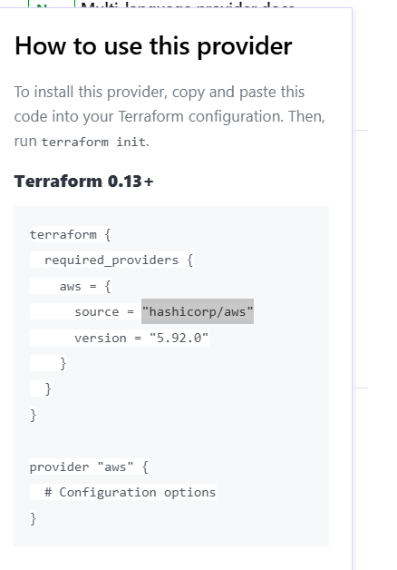
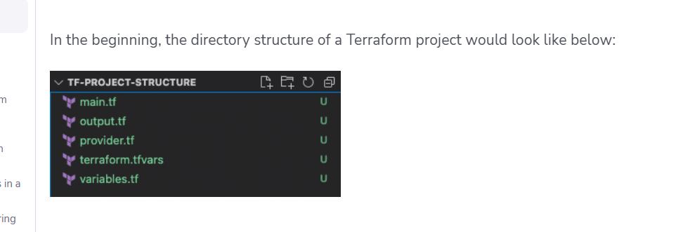

## Hosting a Web Application on an AWS EC2 Server Using ***terraform*** with Custom VPC :

### **Prerequisites**:

- An AWS Account
- ***Basic knowdelge of terraform***

### **Installation Steps** :

#### :star: **Terraform install for Linux users:** 

For latest information and updates refer to this link :point_right: [Terraform-installation-link](https://developer.hashicorp.com/terraform/tutorials/aws-get-started/install-cli)
```
        1. sudo apt-get update && sudo apt-get install -y gnupg software-properties-common
        2. wget -O- https://apt.releases.hashicorp.com/gpg | \
gpg --dearmor | \
sudo tee /usr/share/keyrings/hashicorp-archive-keyring.gpg > /dev/null
        3. gpg --no-default-keyring \
--keyring /usr/share/keyrings/hashicorp-archive-keyring.gpg \
--fingerprint
        4. echo "deb [signed-by=/usr/share/keyrings/hashicorp-archive-keyring.gpg] \
https://apt.releases.hashicorp.com $(lsb_release -cs) main" | \
sudo tee /etc/apt/sources.list.d/hashicorp.list
        5. sudo apt update
        6. sudo apt-get install terraform
```
2. Important command in terraform

    1. ***terraform version*** - To verify the terraform version
    2. ***terraform init*** - to download required version of terraform or providers or module
    3. ***terraform fmt*** - to format the terraform configuration into working directory
    terraforn
    4. ***terraform validate*** - To validate the configuartions into configuration file
    5. ***terraform plan*** - before apply the configuration we verify the required process
    6. ***terraform apply*** - creates the resources on the required provider
    7. ***terraform destroy*** - destory all the resources
    8. ***terraform show*** - Provide the information about state file
    9. ***terraform state show "resource-block-name"*** - provide detailed information about resource block
    10. ***terraform destroy -target="resource-block-name"
1. Provide the terraform provider , here we are using "aws" provider. For reference , how to use the aws provider check this link 👉 : https://registry.terraform.io/providers/hashicorp/aws/latest/docs

2. You can use this below images as well for more clarity: 


3. Specify the ami id for your EC2 server using **data source block** which basically give the information using API query

4. 

5. https://spacelift.io/blog/terraform-tfvars

6. to remove the file from the staging : run this command *** git rm --cached "file-name"

7. /*** to push the new repo to the git hub run these commands :

    1. git init
    2. git add & git commit -m "commit-message" .
    3. git branch -M main
    4. git remote add origin "link"
    5. git remote --set-upstream origin main or git push -u origin main

    ***/

8. provisioner blocks needs to embeeded into resource block, they can't be define on their own
9. The remote-exec provisioner invokes a script on a remote resource after it is created. 


